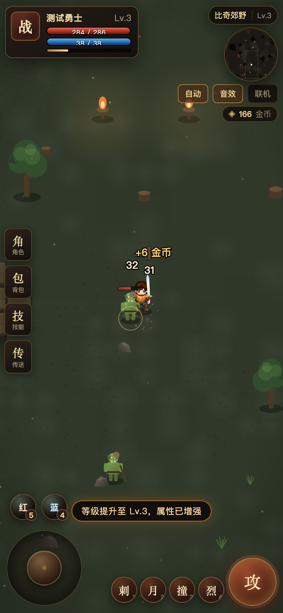
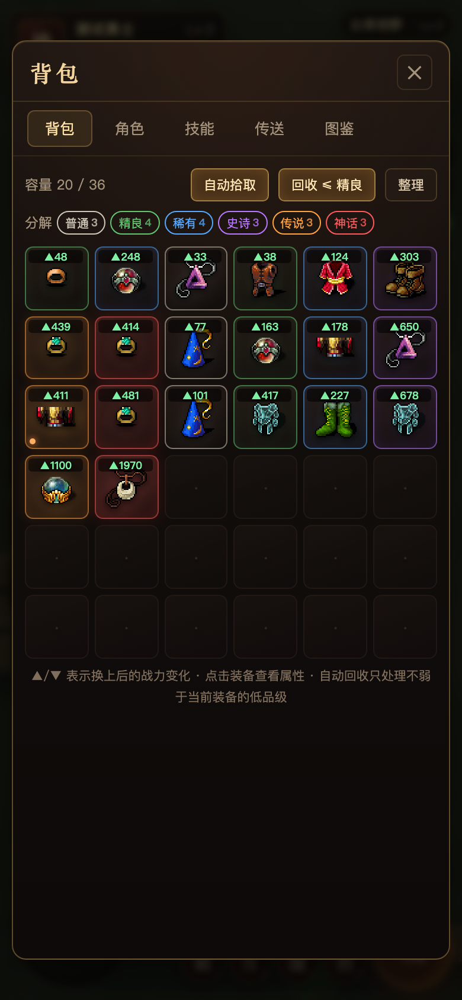
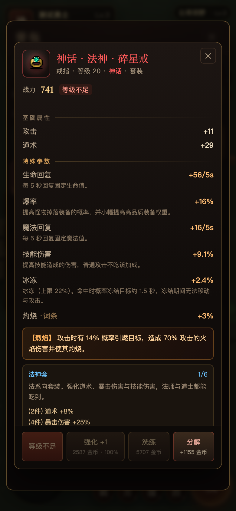
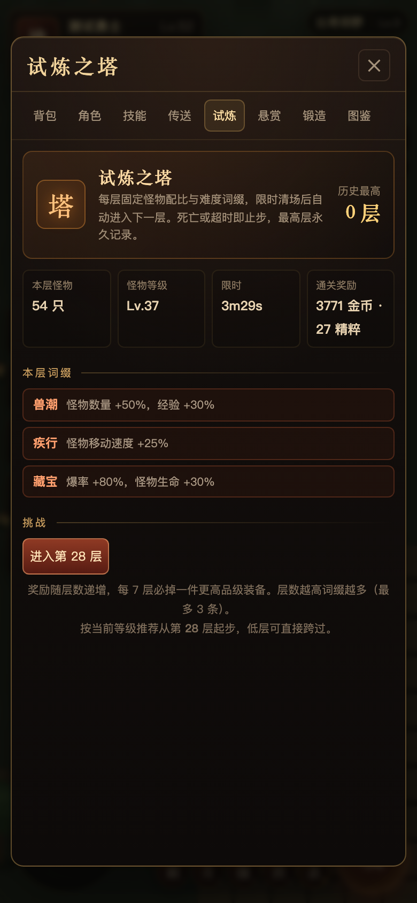
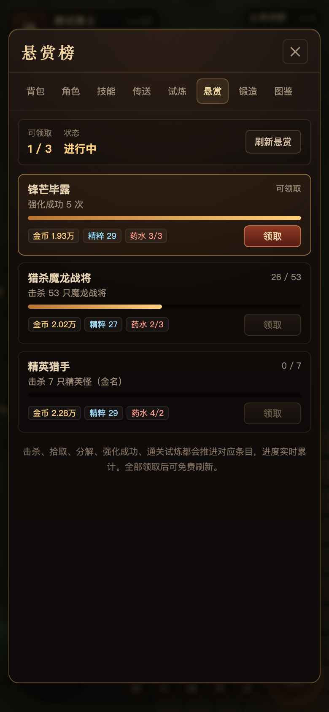
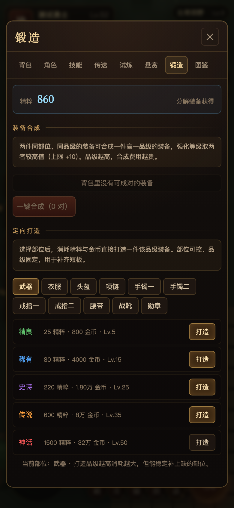
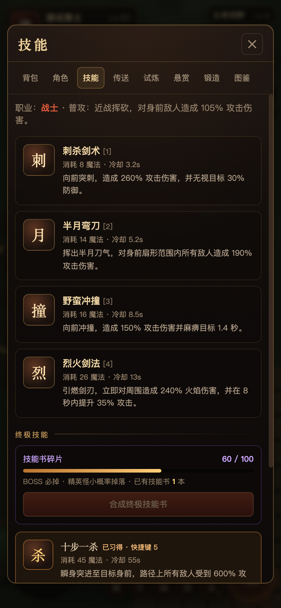
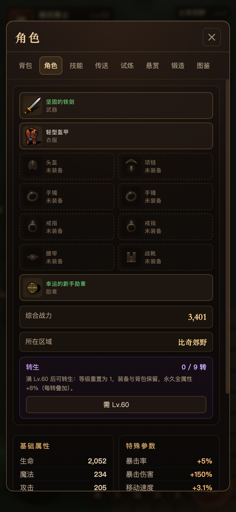
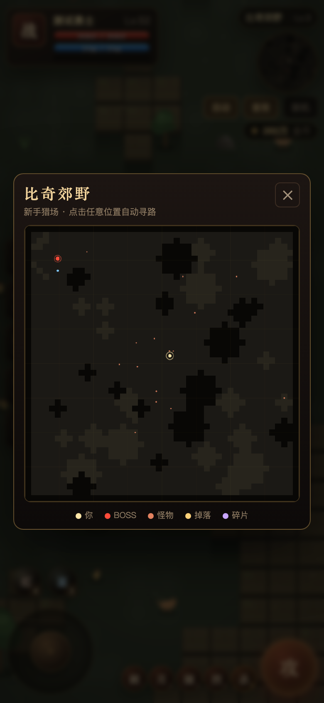

# 赤月传说 · Crimson Moon Legend

一款纯前端 H5 传奇类打宝游戏。构建产物是**一个可双击打开的单文件 HTML**——所有贴图在构建时内联为 data URL；需要联机时再用内置的零依赖 Node 服务开一个局域网房间。

核心卖点：**装备特殊参数体系** —— 稀有度决定词条数量，25 种随机词条 + 9 种传说专属词条 + 3 套套装共鸣，配合强化与洗练，构成完整的"刷装备"循环。

> 纯前端、零运行时依赖、构建后是单个可离线打开的 HTML。如果这个项目对你有帮助，欢迎点个 ⭐ Star；想请作者喝一壶可以看下面的「支持作者」。

| 战斗 | 背包（战力对比 / 自动回收） | 装备详情 |
| --- | --- | --- |
|  |  |  |

| 试炼之塔（无尽层数） | 悬赏榜（每日目标） | 锻造（合成 / 定向打造） |
| --- | --- | --- |
|  |  |  |

| 技能（含终极技能） | 角色（转生） |
| --- | --- |
|  |  |

| 大地图（点击自动寻路） |
| --- |
|  |

---

## 快速开始

```bash
npm install
npm start          # 构建 + 启动本地服务器
```

打开 <http://localhost:5173> 即可游玩。

其他命令：

| 命令 | 说明 |
| --- | --- |
| `npm run build` | 打包到 `dist/index.html`（压缩，约 0.5 MB） |
| `npm run dev` | 打包但不压缩，便于断点调试 |
| `npm run serve` | 启动静态服务器 + 联机服务（需先 build） |
| `PORT=8080 npm run serve` | 指定端口 |

`dist/index.html` 是自包含的，直接双击用浏览器打开也能玩（存档写入 localStorage，按域名/路径隔离），只是**联机需要走 `npm run serve`**。

**操作**：WASD / 方向键移动，`空格` 或 `J` 普攻，`1` ~ `4` 释放对应技能，`Esc` 关闭面板；移动端有虚拟摇杆与技能盘。左侧按钮打开角色、背包、技能、传送面板。

---

## 装备特殊参数体系

这是本作与普通割草小游戏的主要区别：**同一件装备，词条不同，实战强度可能差一倍以上。**

### 1. 稀有度 = 词条数量

| 稀有度 | 颜色 | 特殊词条数 | 基础属性倍率 | 掉落权重 |
| --- | --- | --- | --- | --- |
| 普通 | 灰白 | 0 | ×1.00 | 56 |
| 精良 | 绿 | 1 | ×1.14 | 25 |
| 稀有 | 蓝 | 2 | ×1.32 | 11.5 |
| 史诗 | 紫 | 3 | ×1.56 | 5 |
| 传说 | 橙 | 4 | ×1.88 | 2.1 |
| 神话 | 红 | 5 | ×2.30 | 0.4 |

装备等级越高、BOSS 越强，高品质权重越高（`rollRarity(bonus)` 对高稀有度做指数加权）。

### 2. 25 种随机词条

词条数值 = `随机(最小值..最大值) × (1 + 装备等级 × 成长系数)`，所以高等级装备的同类词条天然更强。

| 类别 | 词条 |
| --- | --- |
| 输出 | 暴击率、暴击伤害、破防、切割（固定真伤）、技能伤害、对 BOSS 伤害、神圣伤害 |
| 持续 | 吸血、反伤、中毒、灼烧、生命回复、魔法回复、击杀回复 |
| 控制 | 麻痹、冰冻 |
| 攻防 | 攻击速度、移动速度、护盾、伤害减免、全属性 |
| 收益 | 爆率、经验加成、金币加成、幸运 |

这些不只是面板数字，全部接入了战斗结算：切割走独立真伤通道、破防按比例削减目标防御、麻痹/冰冻施加硬控、吸血与击杀回复实时回血、护盾优先吸收伤害、爆率/经验/金币参与掉落与结算。

### 3. 传说 / 神话专属词条

传说及以上装备有概率携带一条**具名词条**，除固定属性外还带真实触发效果：

| 词条 | 效果 |
| --- | --- |
| 烈焰 | 攻击 14% 概率引燃，造成 70% 攻击力的火焰伤害并附加灼烧 |
| 雷霆 | 攻击 12% 概率落雷，对目标及周围敌人造成 80% 攻击力的闪电伤害 |
| 霜寒 | 攻击 10% 概率冻结目标 1.6 秒 |
| 嗜血 | 吸血与击杀回复额外提升，击杀时回复 6% 最大生命 |
| 破军 | 无视 6% 防御，对 BOSS 伤害 +8% |
| 圣裁 | 对亡灵系伤害 +30%，攻击附带神圣灼烧 |
| 虚空 | 10% 概率打出 2.4 倍暴击并部分无视防御 |
| 守望 | 受击 20% 概率额外减免 35% 伤害并反弹 30% |
| 贪婪 | 击杀额外获得 12% 爆率与 15% 金币收益 |

具名词条会改变装备名称与配色，是判断装备是否值得留的核心标志。

### 4. 套装共鸣

| 套装 | 部位 | 2 件 | 4 件 | 6 件 |
| --- | --- | --- | --- | --- |
| 圣战 | 武器/衣服/头盔/腰带/靴子/勋章 | 攻击 +8% | 暴击率 +6% | 10% 概率追加 220% 伤害的圣战一击 |
| 法神 | 武器/衣服/头盔/项链/双戒 | 道术 +8% | 暴击伤害 +25% | 技能伤害 +15% |
| 天尊 | 武器/衣服/头盔/项链/双镯 | 经验 +12% | 每秒回复 1% 最大生命 | 减伤 +8%，击杀额外回复 3% 生命 |

套装部位在掉落时随机指定，集齐需要反复刷图。

### 5. 强化 +15

- 每级提升 **8% 基础属性**（不含词条），最高 +15。
- 费用随等级、稀有度、当前强化等级指数增长。
- +1 ~ +4 必定成功；之后成功率从 96% 逐级下降，最低 30%。
- **+10 以上失败会掉一级**，高风险高回报。

### 6. 洗练

消耗金币重铸全部特殊词条（种类与数值完全重随机），词条数量由稀有度决定，不会变多也不会变少。适合把一条数值触底的词条救回来。

### 7. 分解

背包内的装备可分解为金币，白装支持一键批量分解。回收是前期金币的主要来源之一。

### 8. 词条 / 套装说明

游戏内新增 **图鉴** 页签：25 条特殊词条按输出 / 持续 / 控制 / 攻防 / 收益分组，逐条说明结算方式与上限；9 条传说词条与 3 套套装也都有触发条件、部位和 2 / 4 / 6 件效果。

装备详情中，每条特殊词条下方会直接显示机制说明，不需要再猜“破防 / 切割 / 幸运”具体做什么。

---

## 职业与技能

| 职业 | 定位 | 技能 |
| --- | --- | --- |
| 战士 | 近战高血高防 | 刺杀剑术（无视 30% 防御）、半月弯刀（扇形群攻）、野蛮冲撞（麻痹）、烈火剑法（爆发 + 攻击增益） |
| 法师 | 远程高爆发脆皮 | 火球术（溅射）、雷电术（连锁 3 目标）、冰咆哮（区域冰冻）、魔法盾（吸收 + 减伤） |
| 道士 | 持续输出与续航 | 灵魂火符（追踪）、施毒术（区域中毒）、治愈术（瞬回 + 持续回复）、神圣战甲术（防御增益） |

技能有独立法力消耗与冷却，等级上限 60。

### 终极技能

每个职业有两个终极技能。BOSS 必掉「技能书碎片」（精英怪也有小概率掉落），集齐 **100 个碎片** 可在「技能」面板合成一本 **终极技能书**，再用它研习任意一个本职业终极技能。习得后技能会追加到右下角技能栏，快捷键 **5 / 6**。

| 职业 | 终极技能 | 效果 |
| --- | --- | --- |
| 战士 | 十步一杀 | 突进至目标身前，路径上敌人受 600% 攻击伤害并被麻痹 1.6 秒 |
| 战士 | 开天斩 | 三道扇形刀气，每道 320% 伤害并无视 45% 防御，附加灼烧 |
| 法师 | 流星火雨 | 10 颗流星覆盖大范围，每颗 130% 魔法伤害，同一目标最多命中 3 次 |
| 法师 | 冰霜巨龙 | 直线贯穿 560 码，700% 魔法伤害并冰冻 2.5 秒 |
| 道士 | 噬魂沼泽 | 大范围 280% 道术伤害 + 8 秒剧毒，伤害的 30% 转化为自身生命 |
| 道士 | 天罡护体 | 回复 25% 生命，12 秒内 55% 生命护盾、35% 减伤、50% 防御与 30% 反伤 |

终极技能冷却 55~80 秒，属于 BOSS 战 / 试炼高层的关键爆发。

---

## 地图与 BOSS

| 地图 | 进入等级 | 风格 | BOSS |
| --- | --- | --- | --- |
| 比奇郊野 | 1 | 草原 | 半兽人酋长 |
| 沃玛森林 | 8 | 幽暗林海 | 沃玛教主 |
| 祖玛寺庙 | 18 | 沉没石殿 | 祖玛教主 |
| 赤月峡谷 | 30 | 血色裂谷 | 赤月恶魔 |
| 魔龙城 | 42 | 龙焰王座 | 魔龙教主 |

每张地图都是程序化生成（地形噪声 + 洪水填充保证连通），BOSS 固定刷在距边缘 ≥5 格的安全区域，拥有独立技能（冲锋、范围技、召唤等）。等级不足时传送按钮会被锁定。

---

## 挂机与背包工具

打开背包即可看到这些开关，设置会写入存档：

| 功能 | 说明 |
| --- | --- |
| **自动拾取** | 没有活着的目标时自动走过去捡装备；金币 / 药水拾取半径额外 +34px |
| **自动回收** | 可选阈值：关 / ≤ 普通 / ≤ 精良 / ≤ 稀有 / ≤ 史诗。捡到不超过阈值的装备直接换成金币 |
| **自动喝药** | 血量低于 45% 或魔法低于 30% 时自动使用对应药水，受公共冷却限制 |
| **战力对比** | 背包每格左上角显示换上后的战力变化：▲ 绿字变强、▼ 红字变弱，为 0 不显示 |
| **按品级分解** | 工具栏列出 6 个品级及其件数，点一下弹确认框，一次性分解该品级全部装备 |
| **整理** | 按品质、战力降序排列 |

自动回收不会把好装备卖掉：只有在「换上后战力不提升」或「背包里已有同部位更强的」时才会回收。

---

## 地图 / 寻路与自动战斗

- **小地图**：右上角小地图实时显示地形、怪物、BOSS、掉落与技能书碎片
- **大地图**：点击小地图（或按 `M`）打开；点击地图任意位置自动寻路，`Esc` / 右上角关闭
- **自动寻路**：
  - 基于格子网格的 BFS 寻路，8 方向移动并禁止贴墙角穿越
  - 路径会自动拉直，只保留必要的转向点
  - 点到墙里时自动吸附到最近的可站立格子
  - 小地图 / 大地图上会画出当前寻路路径与终点
- **自动战斗**：
  - 每 0.18 秒重新选择**距离自己最近、且视线可达**的怪物
  - 目标隔着墙时不会隔墙攻击，而是自动绕路接近
  - 近战挥砍同样做视线判定，不会穿过墙体命中
- 自动拾取也走寻路，不再直线撞墙

---

## 长线玩法

### 试炼之塔

入口在右侧导航「试炼」。每层固定怪物数量、等级与限时，并按层数从词缀池抽取 0~3 条难度规则；清空全部怪物即通关，3 秒后自动进入下一层。

- 死亡或超时会止步，但**历史最高层永久记录**
- 每 7 层必掉一件更高品级的装备，通关额外获得金币与精粹
- 词缀池：精英横行、兽潮、疾行、狂暴、限时、禁疗、藏宝、铁壁
- 右侧 HUD 会实时显示剩余时间与击杀进度，可随时从面板离开

### 悬赏榜

每天 3 条悬赏，覆盖击杀任意怪、击杀指定怪、精英、BOSS、拾取、分解、强化成功、通关试炼。进度实时累计，领取后获得金币、精粹与药水。

全部领取后可免费刷新；每日 0 点或等级提升 10 级时会自动换一批，保证奖励跟得上角色成长。

### 锻造

| 功能 | 规则 |
| --- | --- |
| **装备合成** | 两件同部位、同品级的装备 → 一件高一品级装备，强化等级取两者较高值（上限 +10） |
| **一键合成** | 自动把背包里所有可成对装备逐级合成，金币不足时停止 |
| **定向打造** | 消耗精粹 + 金币，指定部位、固定品级，用于补齐短板 |

**精粹**是新货币，来源为分解装备（品级 / 等级越高越多）、悬赏奖励与爬塔通关。

### 转生

满 Lv.60 后可转生，最多 9 转：等级重置为 1，装备与背包保留，每转永久全属性 +8%。转生后回比奇郊野重新起步，用高等级装备碾压低级地图，形成第二轮成长曲线。

---

## 局域网联机

```bash
npm run build
npm run serve
# → 赤月传说    http://localhost:5173
# → 局域网联机  http://192.168.x.x:5173
```

手机与电脑连同一个 Wi‑Fi，用终端里打印的**局域网地址**打开游戏，两侧都点右上角「联机」，输入相同房间名即可。

- 每个房间最多 8 人，服务端用 SSE 下行 + POST 上行，零第三方依赖
- 队友会以真实职业精灵图出现在画面中，头顶显示名字、等级与血条
- **队友刷的怪也会同步过来**：脚下有青色虚线环、头顶青色血条，文字标注「队友·怪物名」
- 可以帮队友打怪：你对镜像怪造成的伤害会汇总后发给怪物主人结算，血条与死亡两边一致
- 断线自动重连；用 `file://` 打开时自动降级为单机，不会报错

### 怪物同步怎么算归属

怪物按「谁刷的谁拥有」划分：自己的怪负责 AI、掉落与经验，队友看到的是只做位置插值的镜像。

| 行为 | 自己的怪 | 队友的怪（镜像） |
| --- | --- | --- |
| 移动 / 攻击 AI | 本地跑 | 不跑，跟随主人快照插值 |
| 攻击你 | 会 | 不会（它只打自己的主人） |
| 你打它 | 本地结算、掉经验与战利品 | 本地先扣血做表现，伤害每 0.12s 合并上报给主人结算 |
| 死亡 | 本地 `killMonster` 掉落 | 由主人判定，快照 `hp=0` 后 0.9s 移除 |
| 谁拿经验 / 战利品 | 怪物主人 | 怪物主人（协战算帮忙，不分战利品） |

快照只在同房间、同地图、且怪物在你 1300px 内时上报，单包上限 40 只、每 0.35s 一次；死亡怪物会以 `hp=0` 再上报 3 秒，让队友及时看到消失。

自动战斗仍然打「最近的怪」，但会在 1.35 倍距离内优先选自己的怪——避免挂机时把输出全打在不属于你的战利品上（点地板/点怪手动开打不受这个偏好影响）。

> 联机是「各自刷怪 + 互相可见」的轻量协作版：不做服务端权威判定，也不做跨端掉落共享；好处是断线、单人、局域网都走同一套逻辑。

---

## 支持作者

代码、贴图适配与数值体系全部开源，没有内购、广告和账号系统。如果这个项目帮你省下了几天时间，或者陪你刷了几个晚上的装备，可以请作者喝一壶。

<p align="center">
  　　
  <br>
  <sub>加微信（备注「赤月」，反馈 / 交流）　·　微信支付（赞助完全自愿，不影响任何功能）</sub>
</p>

不想打赏也完全没问题：点个 **Star** ⭐、提个 Issue、或者把游戏发给一起开黑的朋友，都是很好的支持。

> 收款码仅用于个人赞助；本项目不提供付费内容，也不会收集任何账号信息。

---

## 美术素材

装备图标与角色模型使用可免费商用的开源素材，构建时内联为 data URL，产物仍是单文件：

| 用途 | 来源 | 授权 |
| --- | --- | --- |
| 装备图标（12 部位 × 各档位，共 80 张） | [RLTiles / Dungeon Crawl Stone Soup](https://github.com/crawl/crawl/tree/master/crawl-ref/source/rltiles) | Public Domain |
| 三职业角色精灵图（行走 8 帧 / 攻击 6 帧 × 三向） | [Universal LPC Spritesheet Generator](https://github.com/sanderfrenken/Universal-LPC-Spritesheet-Character-Generator) | CC-BY-SA 3.0 / GPL 3.0 |

完整署名与再生成方法见 [`assets/CREDITS.md`](assets/CREDITS.md)。重新抓取素材：

```bash
python3 tools/fetch-assets.py          # 增量下载并合成精灵表
python3 tools/fetch-assets.py --force  # 强制重下
npm run build
```

脚本会：

- 把 DCSS 32×32 图块最近邻放大到 64×64，写进 `assets/items/<baseId>.png`；腰带类从胸甲图块裁取横带并加 1px 描边
- 按职业叠加 LPC 的 身体 / 护腿 / 靴子 / 衣服 / 头部 / 头发 图层，抽取 8 列 × 6 行精灵表到 `assets/chars/<cls>.png`
- 生成 `assets/manifest.json`，`build.mjs` 读取后内联

想换素材时只需替换 `assets/` 下的图并保持 `manifest.json` 的映射；缺图或图片尚未解码完成时自动回退程序化美术，不会报错。

> 传奇 / 传奇世界客户端的原始贴图属于商业版权素材，仓库不附带。

---

## 项目结构

```
src/
  index.html          页面骨架 + 全部 CSS（开始页 / HUD / 各面板 / 详情浮层 / 死亡页）
  main.js             启动流程、职业选择、读档、调试入口
  core/
    util.js           数学、随机、格式化、颜色工具
    audio.js          WebAudio 合成音效（无音频文件）
    input.js          键盘 / 虚拟摇杆 / 画布点击
  data/
    gamedata.js       全部静态数据：职业、12 技能 + 6 终极、装备基底、25 词条、9 传说词条、3 套装、怪物、5 地图
  game/
    items.js          装备生成、稀有度、词条 roll、强化、洗练、分解、战力计算
    player.js         属性聚合、套装判定、Buff、升级、序列化
    world.js          程序化地图、连通性、地形与小地图预渲染
    game.js           主循环、战斗结算、怪物 AI、BOSS 技能、掉落、死亡复活、存档
    systems.js        试炼塔配置推导、悬赏生成与进度、合成/打造/转生规则
  ui/
    render.js         大地图渲染、角色精灵图 / 程序化怪物、队友、粒子与光效、小地图
    icons.js          装备图标（外部贴图优先，回退程序化绘制）与掉落/背包/角色面板共用
    assets.js         贴图映射与异步解码缓存（装备图标 / 角色精灵图）
    hud.js            HUD、飘字、Toast、血条
    mapview.js        大地图（小地图点击打开、点击自动寻路）
    panels.js         背包 / 角色 / 技能 / 传送 / 试炼 / 悬赏 / 锻造 / 装备图鉴 / 装备详情
  net/
    net.js            局域网联机客户端（SSE 下行 + fetch 上行）
  generated/
    assets.js         构建时生成的内联素材映射
assets/
  items/*.png         装备图标（DCSS RLTiles，公有领域）
  chars/*.png         三职业精灵表（LPC，CC-BY-SA 3.0）
  manifest.json       贴图映射与精灵表布局
  CREDITS.md          素材署名与授权
tools/                无头浏览器（CDP）验证脚本 + 素材抓取脚本
build.mjs             esbuild 打包为单文件 HTML
serve.mjs             本地静态服务器
```

### 构建方式

`build.mjs` 用 esbuild 把 `src/main.js` 及其依赖打成 IIFE，注入 `src/index.html` 的 `<!--APP_SCRIPT-->` 占位符，输出 `dist/index.html`。整个游戏没有运行时依赖。

---

## 自动化验证

`tools/` 下的脚本通过 Chrome DevTools Protocol 驱动无头浏览器，无需 Playwright：

```bash
node tools/interact.mjs   # 装备 / 强化 / 洗练 / 药水 / 存档恢复
node tools/skills.mjs     # 三职业全部技能 / 传送 / BOSS 战 / 死亡复活
node tools/zones.mjs      # 5 张地图循环 + 320px 窄屏布局溢出检查
node tools/net.mjs        # 起服务 + 两个客户端：房间发现、位置同步、怪物双向可见、协战伤害、死亡同步
node tools/systems.mjs    # 试炼塔 / 悬赏 / 合成 / 打造 / 转生 / 面板渲染
node tools/map.mjs        # 大地图打开 / 点击寻路 / 路径不穿墙 / 隔墙不攻击 / 最近目标
node tools/shots.mjs      # 生成玩法面板截图到 docs/
node tools/probe.mjs      # 截图 + HUD 元素度量
```

脚本会输出结构化 JSON，结尾的 `errors` 数组为空即代表本次无运行时异常。页面上的 `data-js-error` 属性会记录首次未捕获异常，`data-ready="1"` 表示已进入游戏。

调试时可用 `#autostart=warrior|mage|taoist` 跳过开始页直接进入（会写入存档），`window.__CM` 暴露了 `game / PANELS / HUD / RENDER / ITEMS / PLAYER / DATA / SYSTEMS`。

> 注意：存档 key 为 `crimson-moon-save-v3`。改动存档结构时请同步升级 `DATA.VERSION` 与 key，避免旧档解析失败。

---

## 设计说明

- **贴图 + 程序化混合**：装备图标与三职业角色使用开源像素素材（DCSS RLTiles / LPC），地形、怪物、粒子与光效仍由 Canvas 实时绘制，构建后仍是单个 HTML。
- **传奇式装备图标**：每个基底（`w_wood` 桃木剑、`w_iron` 铁剑、`w_judge` 裁决之刃…）都有独立贴图，品质差异由外框配色与辉光表达；背包、角色面板、装备详情与世界掉落共用同一套图标。
- **四向角色精灵**：行走 8 帧、攻击 6 帧，支持上下左右朝向与左右翻转；未移动时保持上一次朝向。
- **武器随装备变化**：角色手中会按当前武器类型画出剑 / 斧 / 杖 / 道剑 / 扇，传说以上带品质光晕，攻击时同步挥砍；背对镜头时武器藏在身后。
- **分层技能特效**：烈火剑法的火月牙与翻卷火舌、半月弯刀的实心月牙刀光、刺杀剑术的贯穿剑气、野蛮冲撞的地面冲击波、雷电术的分叉连锁、冰咆哮的冰盘与冰刺、施毒术的毒池气泡、魔法盾的六边护盾泡、神圣战甲术的金色法阵，命中时还有元素色冲击星芒。
- **装备联动**：武器类型与品质体现在角色手持武器、装备图标、详情页稀有度配色与战斗特效颜色上。
- **移动端优先**：竖屏布局，摇杆 + 技能盘；对 390px / 360px / 320px 做了断点适配。
- **legend 风格**：宋体标题、金色渐变描边、稀有度配色（白/绿/蓝/紫/橙/红）、暗色羊皮纸面板。
- **存档**：每 18 秒自动保存，并在 `visibilitychange` / `pagehide` / `beforeunload` 时补存。

---

## 参考

构建与目录组织参考了 [riba2534/claude-opus-5-5-demo](https://github.com/riba2534/claude-opus-5-5-demo) 的「多 ES 模块 + esbuild 单文件产物」思路；游戏玩法与数值体系为原创实现。
